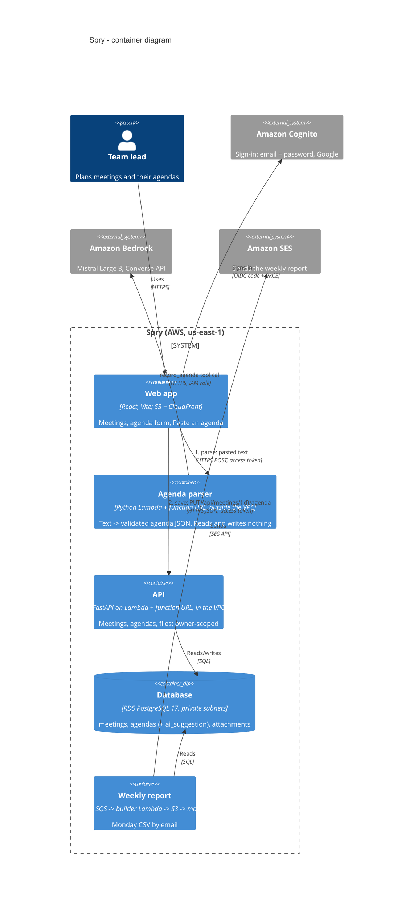

# Spry — containers (C4, level 2)

What runs where, and which arrow carries what. Updated for "Paste an agenda"
([ADR 0004](decisions/0004-llm-agenda-parsing.md)): the **parse** path goes browser → parser →
Bedrock and touches no data; the **save** path is the normal browser → API → database one.



Plain-text version:

```
                      ┌──────────── parse (suggests only) ────────────┐
browser ──HTTPS──> agenda-parser Lambda (no VPC) ──IAM──> Bedrock (Mistral Large 3)
   │                  checks token, ≤10k chars, validates JSON, logs tokens + cost
   │
   └──HTTPS──> API Lambda (VPC) ──SQL──> RDS PostgreSQL
                  PUT /api/meetings/{id}/agenda  (the only write; stores ai_suggestion too)
```
